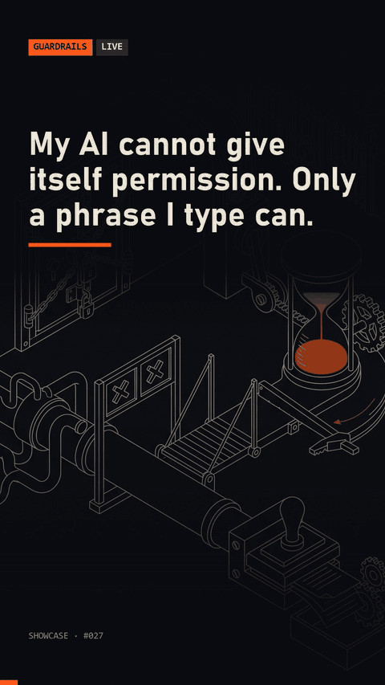

# consent-tokens

Consent tokens for Claude Code: a PreToolUse hook denies risky action groups by default; a UserPromptSubmit hook opens a group for 30 minutes in one session when the user types a permission phrase. Model output cannot trigger a grant; another phrase revokes it.



## Quick start

```
python demo.py
```

This replays the whole flow against the real hooks: denied, the user types `allow pay`, allowed, a second session is still denied, `revoke consent`, denied again. Run the tests with `python -m unittest discover -s tests`.

To use it in Claude Code, add both hooks to `.claude/settings.json` (replace the path):

```json
{
  "hooks": {
    "UserPromptSubmit": [{"hooks": [{"type": "command", "command": "python /path/to/consent-tokens/consent_tokens/grant.py"}]}],
    "PreToolUse": [{"matcher": ".*", "hooks": [{"type": "command", "command": "python /path/to/consent-tokens/consent_tokens/guard.py"}]}]
  }
}
```

## Requirements

Python 3.8+, standard library only.

## How it works

- `consent_tokens/groups.json` defines the risky groups (`pay`, `api`, `cloud`): the tools they apply to and the regex patterns that mark a call as risky. Edit it freely.
- `guard.py` runs before every tool call. If the call matches a closed group it returns `permissionDecision: deny` with instructions for the model to stop and ask.
- `grant.py` runs on every user prompt. A phrase such as `allow pay` (or `allow all`) writes a grant keyed by the `session_id`, valid for 30 minutes. Hooks on `UserPromptSubmit` only ever see what the human typed, so the model cannot produce the phrase.
- Negated or quoted phrases ("never say allow pay") grant nothing. `revoke consent` closes everything early.
- Settings: `CONSENT_MINUTES` (default 30), `CONSENT_KEYWORD` (default `allow`), `CONSENT_STATE_DIR`, `CONSENT_GROUPS` (path to your own groups file).

## License

MIT, see [LICENSE](LICENSE).

Built with Claude Code. Write-up: https://made-by-asking.pages.dev/showcase/consent-tokens/
